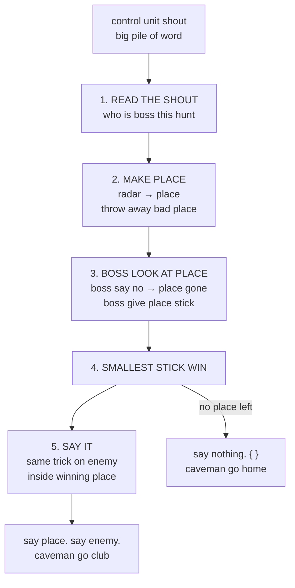

# The rock, explained to caveman

For [app/services/objective_selector.rb](../app/services/objective_selector.rb) and the five small
rock in [app/services/objective_selection/](../app/services/objective_selection/). Ugh.

## What rock do?

Many place have enemy. Caveman have one club. Caveman hit ONE place.

**This rock pick the place.** Then rock say which enemy in place get clubbed first.

## Whole rock in five grunt



That all. Rest is small detail.

One grunt, one file. Caveman never hunt in wrong cave.

## Five grunt, five small rock

Every grunt above is real code. Here the code.

### Grunt 1. READ THE SHOUT — `ParseRequest`

```ruby
def call
  payload = parse
  Request.new(AttackMode.build(payload["attack-mode"]), Array.wrap(payload["radar"]))
end
```

`parse` chew the word-pile into thing caveman understand. `AttackMode.build` fetch the boss, and
shout if caveman ask for boss that not exist, or two boss that hate each other. `Array.wrap` — radar
send one place not in list? Put in list anyway.

Boss get fetched FIRST, before radar even looked at. Reason down below.

### Grunt 2. MAKE PLACE — `BuildCandidates`

```ruby
def call
  radar.each_with_index
       .filter_map { |raw, index| Radar::Area.from(raw, index:) }
       .select(&:attackable?)
end
```

`each_with_index` — remember who came first, second, third. `filter_map` — chewed-up place come back
`nil`, throw `nil` in fire. `select(&:attackable?)` — place with nothing worth clubbing is not place,
is just dirt. Dirt gone too.

### Grunt 3. BOSS LOOK AT PLACE — `ApplyModes`

```ruby
def call
  areas.select { |area| modes.all? { |mode| mode.allows?(area) } }
       .map { |area| Ranked.new(area, modes.map { |mode| mode.area_rank(area) }) }
end
```

Two thing, one grunt, because boss do two thing.

**Boss say no** — `all?` mean EVERY boss must say yes. One boss say no, place gone.

**Boss give stick** — every place that live get row of stick, one stick per boss. Place carry stick
to next grunt. See stick section below.

### Grunt 4. SMALLEST STICK WIN — `SelectWinner`

```ruby
def call
  ranked.min_by { |candidate| key(candidate) }&.area
end

def key(candidate)
  area = candidate.area
  [ *candidate.mode_ranks, -area.total_damage, area.index ]
end
```

Boss stick go in FRONT. Behind boss stick, two more stick that boss not control: **big damage**, then
**who came first on radar**.

`min_by` — hold up every stick row, keep smallest. No place left? `min_by` give `nil`, `&.` keep
caveman from tripping over `nil`, caveman go home.

### Grunt 5. SAY IT — `BuildResponse`

```ruby
def call
  return {} if area.nil?

  { position: { x: area.x, y: area.y }, targets: target_types }
end

def target_types
  area.attackable_targets
      .sort_by.with_index { |target, index| key(target, index) }
      .map(&:type)
end

def key(target, index)
  [ *modes.map { |mode| mode.target_rank(target) }, -target.damage, index ]
end
```

Look same as grunt 3 and 4 squashed together. **Is same.** Place get stick and smallest win; enemy
get stick and smallest go first in line. Caveman learn trick once, use twice.

### And the rock that hold all five — `ObjectiveSelector`

```ruby
def call
  request    = ObjectiveSelection::ParseRequest.new(body).call
  candidates = ObjectiveSelection::BuildCandidates.new(request.radar).call
  ranked     = ObjectiveSelection::ApplyModes.new(candidates, request.modes).call
  winner     = ObjectiveSelection::SelectWinner.new(ranked).call

  ObjectiveSelection::BuildResponse.new(winner, request.modes).call
end
```

Five line. Five grunt. This rock decide NOTHING. This rock only point: you go, then you go, then
you go. Caveman read five line, caveman know whole hunt.

## SMALL NUMBER WIN. Caveman remember this.

`min_by` and `sort_by` mean *pick smallest*. Small number good. Big number bad.

But caveman WANT club place with big damage! Big damage is big number! Problem!

No problem. Put minus in front:

```
place with 190 damage  ->  -190
place with  20 damage  ->  -20

-190 smaller than -20  ->  big damage place win
```

Caveman flip the stick. Now big is small. Ugh. Clever.

That the `-` in `-area.total_damage` inside `SelectWinner#key`, and the `-` in `-target.damage`
inside `BuildResponse#key`. Same trick, both place. **One idea, not two.**

## Number not one number. Number is STICKS IN ROW.

Caveman look at `SelectWinner#key`:

```ruby
[ *candidate.mode_ranks, -area.total_damage, area.index ]
   └── what boss say ──┘  └ big damage ┘      └ radar order ┘
```

Is row of stick. Compare row of stick like this:

1. Look at **first** stick of each place. Smaller stick win. **Done.**
2. First stick same size? Then look at **second** stick. Smaller win. Done.
3. Second same too? Look at **third**. Third is radar order. Two place never share that.
   Always a winner.

Ruby do this by self with `[ ]`. Caveman not write the compare. Caveman just make good stick.

## Why boss stick go FIRST

Boss talk first, boss get listened to first.

Caveman say `priorize-t-x`? Then first stick is "place have T-X? yes = 0, no = 1".
`0` smaller than `1`. Place with T-X win. **Always.** Even if far. Even if weak.
Boss said T-X. Boss get T-X.

Which boss loudest? Not where caveman put boss in list. Each boss carry own loudness number
(`priority`). T-X boss is `10`, far/near boss is `20`. Small number = loud boss = talk first.

```
caveman shout [ "closest-first", "priorize-t-x" ]
caveman shout [ "priorize-t-x", "closest-first" ]

           SAME HUNT. SAME PLACE CLUBBED.
```

Resistance paper say attack must **ALWAYS** club T-X, and paper own example put T-X boss last in
list. If list order decide loudness, then paper example make "always" into lie. Paper not lie.
So list order decide nothing.

Damage stick and radar-order stick sit at the back. They only get looked at when boss stick all tie.
Caveman never flip coin.

## Watch caveman pick

Caveman say `priorize-t-x`. Three place:

| place | have T-X? | damage | radar order | sticks |
|---|---|---|---|---|
| `(0,20)` | no → `1` | 110 → `-110` | `0` | `[1, -110, 0]` |
| `(0,80)` | no → `1` | 20 → `-20` | `1` | `[1, -20, 1]` |
| `(0,90)` | YES → `0` | 130 → `-130` | `2` | `[0, -130, 2]` ← **club this one** |

First stick: `0` beat `1`. Over. Caveman never even look at damage.

Boss not say `priorize-t-x`? Then no boss stick at all, and damage stick decide: `(0,20)` win with
`-110`. Caveman club loudest place.

Now same trick on enemy inside `(0,90)` — `BuildResponse#key`:

| enemy | is T-X? | damage | sticks | place in line |
|---|---|---|---|---|
| `T-X` | YES → `0` | 20 → `-20` | `[0, -20, 0]` | first |
| `HK-Bomber` | no → `1` | 80 → `-80` | `[1, -80, 2]` | second |
| `T7-T` | no → `1` | 30 → `-30` | `[1, -30, 1]` | third |

T-X weakest but go first, because boss said so. Other two line up big-hitter first.

Caveman shout back:

```json
{"position":{"x":0,"y":90},"targets":["T-X","HK-Bomber","T7-T"]}
```

## Three thing that look weird

**Human with damage still not get clubbed.** In `Radar::Target`:

```ruby
def attackable? = type.present? && !human? && damage.is_a?(Numeric)
```

Caveman never club human. Not even human that somehow carry damage number. Briefing say so, rock
say so, done. `avoid-crossfire` is different thing — that boss say *do not swing club NEAR human*,
not *do not put human on list*.

**Garbage in, empty out.** In `ParseRequest`:

```ruby
parsed.is_a?(Hash) ? parsed : {}
```

Control unit send garbage instead of radar? Caveman not explode. Caveman treat garbage as empty.

**Boss fetched before radar looked at.** Grunt 1 build boss list, THEN pass radar along. Why care
about order?

Because radar sometimes empty. Empty radar, and if boss only fetched later, caveman never notice
control unit asked for two opposite boss. Bad! Caveman fetch boss FIRST, out loud, so broken order
make noise even when radar empty.

## Where each grunt live

| grunt | rock |
|---|---|
| point at all five | [objective_selector.rb](../app/services/objective_selector.rb) |
| 1. read the shout | [parse_request.rb](../app/services/objective_selection/parse_request.rb) |
| 2. make place | [build_candidates.rb](../app/services/objective_selection/build_candidates.rb) |
| 3. boss look at place | [apply_modes.rb](../app/services/objective_selection/apply_modes.rb) |
| 4. smallest stick win | [select_winner.rb](../app/services/objective_selection/select_winner.rb) |
| 5. say it | [build_response.rb](../app/services/objective_selection/build_response.rb) |

No line number in this table. Line number lie every time caveman touch rock. File name not lie.

## Why rock small and never grow

Rock not know what `closest-first` mean. Rock not know what `avoid-crossfire` mean. Rock never
say the name of any mode. Rock only know: **ask boss, make stick, pick smallest.**

Skynet build new mode tomorrow? New mode is new file. Boss list get one more line. These five rock
**not change**. Rock already know how to listen.

Caveman happy. Caveman go club T-X now.
