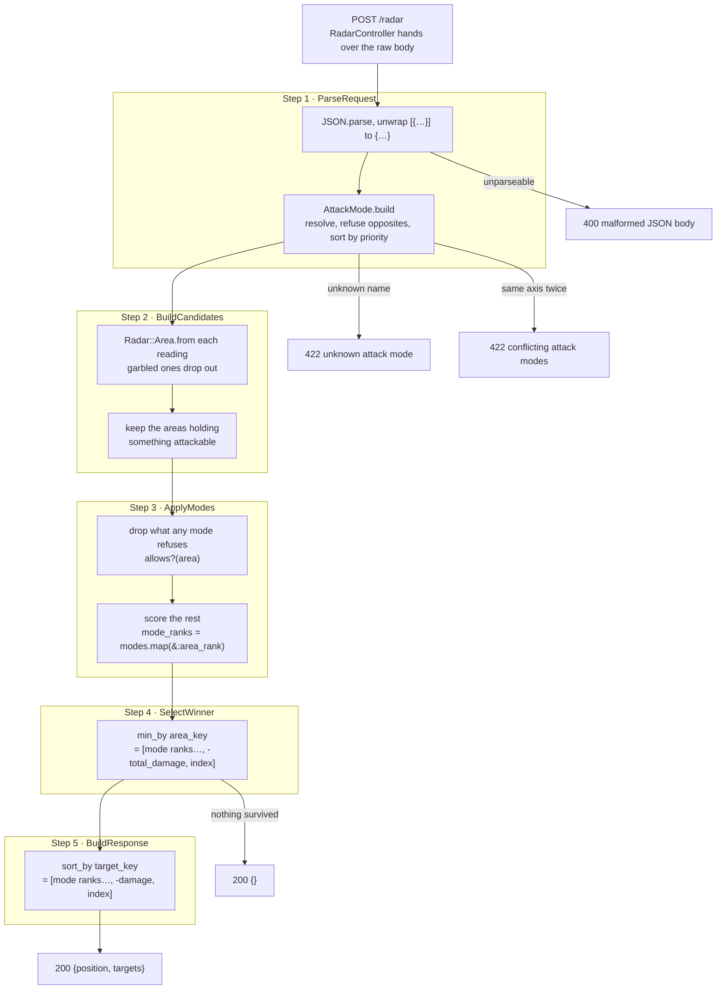

# Workflow

What happens between the control unit's POST and the answer.

## The pipeline

Five steps, one service each, exactly the boxes the briefing draws.



Steps 3 and 4 are the whole idea: the modes rank the areas, the best area wins, and then in step 5
the same modes rank the targets inside it. Everything else is parsing and refusing bad input.

The two middle steps are split where they are on purpose. Step 3 does what a mode can do — rule out
and rank — and hands each survivor on with the ranks it earned. Step 4 does what no mode does:
settle whatever is still tied, the same way every time.

## A request traced end to end

Case 3 of the shipped battery, the one that shows `priorize-t-x` doing both of its jobs:

```json
{"attack-mode":["priorize-t-x"],"radar":[
  {"position":{"x":0,"y":20},"targets":[{"type":"T7-T","damage":30},{"type":"HK-Bomber","damage":80}]},
  {"position":{"x":0,"y":80},"targets":[{"type":"HK-Tank","damage":20}]},
  {"position":{"x":0,"y":90},"targets":[{"type":"T-X","damage":20},{"type":"T7-T","damage":30},{"type":"HK-Bomber","damage":80}]}]}
```

**Choosing the area.** One mode is in play and it filters nothing, so all three reach step 4 and
`area_key` is `[tx_rank, -total_damage, index]`:

| area | holds a T-X? | total damage | `area_key` | |
|---|---|---|---|---|
| `(0,20)` | no → `1` | 110 | `[1, -110, 0]` | |
| `(0,80)` | no → `1` | 20 | `[1, -20, 1]` | |
| `(0,90)` | yes → `0` | 130 | `[0, -130, 2]` | **lowest — chosen** |

The T-X settles it at element 0, before damage is even looked at. Note `(0,90)` is also the furthest
area on the radar: without `priorize-t-x` the tie-break would take over and the most dangerous area
`(0,20)` would have won on `-110 < -20`.

**Ordering its targets.** Same mode, so `target_key` is `[tx_rank, -damage, index]`:

| target | is a T-X? | damage | `target_key` | position |
|---|---|---|---|---|
| `T-X` | yes → `0` | 20 | `[0, -20, 0]` | 1st |
| `HK-Bomber` | no → `1` | 80 | `[1, -80, 2]` | 2nd |
| `T7-T` | no → `1` | 30 | `[1, -30, 1]` | 3rd |

The T-X is reported first despite having the *least* damage of the three; the other two fall in
behind it hardest-hitting first.

```json
{"position":{"x":0,"y":90},"targets":["T-X","HK-Bomber","T7-T"]}
```

Which is byte for byte what `test_cases.json` expects.

## Where each step lives

| step | file |
|---|---|
| read the raw body, map errors to status codes | [app/controllers/radar_controller.rb](../app/controllers/radar_controller.rb) |
| the five steps, in order | [app/services/objective_selector.rb](../app/services/objective_selector.rb) |
| 1 · parse and validate the request | [app/services/objective_selection/parse_request.rb](../app/services/objective_selection/parse_request.rb) |
| 2 · build the candidate areas | [app/services/objective_selection/build_candidates.rb](../app/services/objective_selection/build_candidates.rb) |
| 3 · apply the attack mode rules | [app/services/objective_selection/apply_modes.rb](../app/services/objective_selection/apply_modes.rb) |
| 4 · select the winning area | [app/services/objective_selection/select_winner.rb](../app/services/objective_selection/select_winner.rb) |
| 5 · build the response | [app/services/objective_selection/build_response.rb](../app/services/objective_selection/build_response.rb) |
| resolve mode names, refuse unknown and opposite ones | [app/models/attack_mode.rb](../app/models/attack_mode.rb) |
| what a mode may answer | [app/models/attack_mode/base.rb](../app/models/attack_mode/base.rb) |
| the four modes themselves | [app/models/attack_mode/](../app/models/attack_mode/) |
| parse a reading, survive a garbled one | [app/models/radar/area.rb](../app/models/radar/area.rb), [app/models/radar/target.rb](../app/models/radar/target.rb) |
